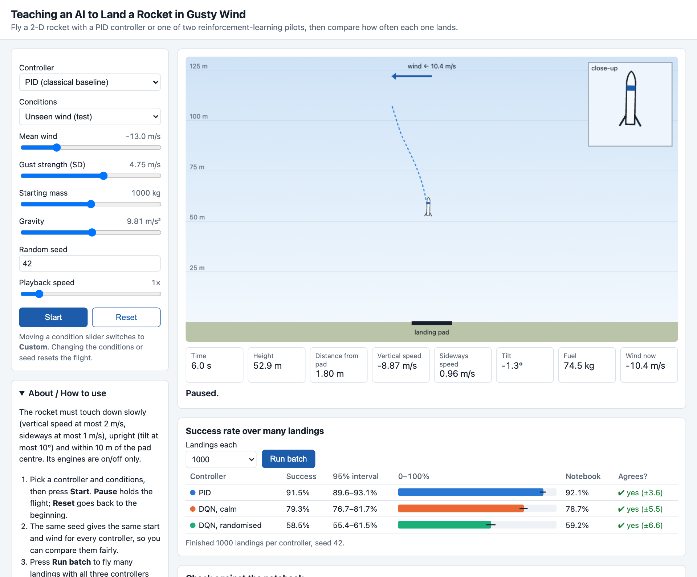
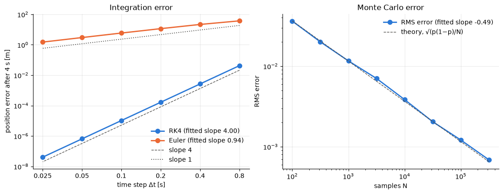

# Teaching an AI to Land a Rocket in Gusty Wind

A 2-D rocket-landing simulator that tests whether a reinforcement-learning pilot trained with **domain randomisation** lands more reliably in unseen wind than a pilot trained in calm air or a classical PID controller.

**[Live demo](https://nipunmeegoda.github.io/rl-rocket-simulator/)** · [](https://colab.research.google.com/github/nipunmeegoda/rl-rocket-simulator/blob/main/notebook/rl-rocket-simulator.ipynb)



## The problem

Reusable rockets such as SpaceX's Falcon 9 now land vertically under automated guidance, and reinforcement learning (RL) is being explored as an alternative to hand-tuned controllers. A known weakness of learned controllers is that a policy trained in one simulated world can fail when conditions change. Robustness to the unexpected is one of the main barriers to trusting AI controllers in safety-critical systems.

This project asks one question: **does training with domain randomisation (randomised mass, gravity and wind in every episode) make a Deep Q-Network (DQN) agent land more reliably under unseen wind conditions than (a) the same agent trained in calm conditions and (b) a classical PID controller?** Each controller is scored by its landing success rate over 1,000 Monte Carlo test landings, reported with 95% confidence intervals.

## Quick start

**Notebook:** click the *Open in Colab* badge above, then *Runtime → Run all*. By default the notebook loads pre-trained weights, so a full run takes about [TODO: N] minutes on a free runtime. Set `RETRAIN = True` to train the agents from scratch.

**Web demo:** open the [live demo](https://nipunmeegoda.github.io/rl-rocket-simulator/), or download this repository and double-click `docs/index.html`.

**Run locally (optional):**

```bash
pip install -r requirements.txt
jupyter notebook notebook/rl-rocket-simulator.ipynb
```

## Using the demo

Choose a controller (PID, calm-trained DQN or domain-randomised DQN), set the wind strength, gust variability and random seed, then press **Start** to watch a landing. Run a batch of episodes to estimate the success rate with its confidence interval. Full guide: [USER_GUIDE.md](USER_GUIDE.md).

## Model and mathematics

The rocket is a 2-D rigid body with state $(x, y, v_x, v_y, \theta, \omega, m)$. Translation follows Newton's second law under thrust, gravity and aerodynamic drag relative to a stochastic wind; rotation follows $I\,\dot\omega = \tau$ from the side thrusters; and fuel burns as

$$\frac{dm}{dt} = -\frac{T}{I_{sp}\, g_0}.$$

The equations are integrated with the classical fourth-order Runge–Kutta method (RK4). The learning agent is a DQN with a discrete action set (main engine, side thrusters and their combinations) and a shaped reward. Full derivations, assumptions and parameters: [THEORY.md](THEORY.md).

## Verification

The simulator is checked against closed-form results before any controller is trained:

- free fall matches $y(t) = y_0 + v_0 t - \tfrac{1}{2} g t^2$;
- a constant-thrust burn matches the Tsiolkovsky rocket equation $\Delta v = I_{sp} g_0 \ln(m_0/m_1)$;
- torque-free motion keeps $\omega$ constant, and mechanical energy is conserved when thrust and drag are off;
- the RK4 error falls as $O(\Delta t^4)$ on a log–log plot.

[TODO: state the measured results, e.g. fitted convergence slope and maximum free-fall error.]



## Concepts applied

This project applies reinforcement learning (Deep Q-Networks with experience replay and a target network) and domain randomisation for sim-to-real-style robustness; numerical integration of ordinary differential equations with the fourth-order Runge–Kutta method, including a measured convergence-order check; input modelling and random variate generation for stochastic wind gusts and randomised physical parameters; and Monte Carlo estimation of success probabilities with confidence intervals based on the law of large numbers. The simulator is verified against analytic free-fall, rocket-equation and conservation results.

## Results

[TODO: answer the question with the success-rate table (with 95% CIs) for the three controllers under unseen wind, and the success-rate-versus-wind-strength figure.]

## Limitations and future work

- The model is 2-D and rigid: there is no out-of-plane motion, fuel slosh, structural flexing or engine gimbal dynamics, and all physical parameters are synthetic rather than taken from a real vehicle.
- Actions are discrete (engines on or off), whereas real landing engines throttle continuously.
- Results are from simulation only; a policy that is robust here is not proven robust on hardware.
- Planned extension: noisy sensors with a Kalman filter that estimates the state before it is passed to the agent.

## Key references

1. V. Mnih *et al.*, "Human-level control through deep reinforcement learning," *Nature*, vol. 518, no. 7540, pp. 529–533, 2015, doi: 10.1038/nature14236.
2. J. Tobin *et al.*, "Domain randomization for transferring deep neural networks from simulation to the real world," in *Proc. IEEE/RSJ IROS*, 2017, pp. 23–30, doi: 10.1109/IROS.2017.8202133.
3. R. S. Sutton and A. G. Barto, *Reinforcement Learning: An Introduction*, 2nd ed. MIT Press, 2018.

Full list: [REFERENCES.md](REFERENCES.md).

## AI assistance

Developed with the help of AI coding and writing assistants. All code was reviewed, run and verified by the author.

## Licence and credits

Code: [MIT](LICENSE). Data: no external datasets are used; all physical parameters are synthetic and stated in [THEORY.md](THEORY.md).
