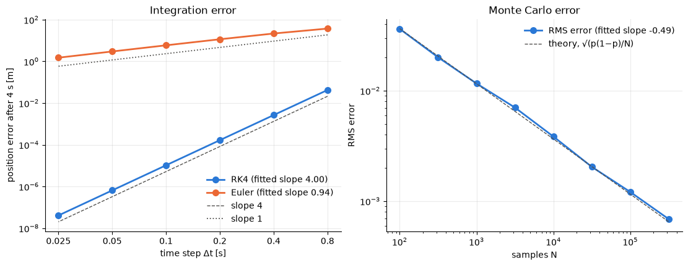

# Theory and mathematics

## 1. Problem formulation

A small reusable rocket descends towards a landing pad in a vertical 2-D plane and must touch down slowly, upright and close to the pad while horizontal wind gusts push it off course. Three controllers fly it:

1. a **PID controller** (classical baseline);
2. a **DQN agent trained in calm conditions**;
3. a **DQN agent trained with domain randomisation** of mass, gravity and wind.

**Question:** under wind conditions not seen in training, which controller lands most reliably?

**Quantity of interest:** the landing success probability $p$ of each controller, estimated from $n = 1000$ Monte Carlo test episodes with a 95% confidence interval.

An episode is a **success** if, at first ground contact,

$$|v_y| \le v_{y,\max}, \quad |v_x| \le v_{x,\max}, \quad |\theta| \le \theta_{\max}, \quad |x - x_{pad}| \le d_{\max},$$

with the limits given in the parameter table. An episode fails on any other touchdown, on leaving the flight area, on running out of fuel before landing, or on exceeding the time limit. The state at ground contact is found by linear interpolation to $y = 0$ within the last step.

## 2. Assumptions

1. **Planar rigid body.** Motion is restricted to the vertical $x$–$y$ plane. This captures the essential landing problem (descent, drift, tilt) at low cost.
2. **Uniform gravity.** $g$ is constant over the short descent (a few km at most).
3. **Main engine along the body axis.** There is no gimbal; the rocket steers by tilting with the side thrusters.
4. **Side thrusters produce pure torque.** Their net force is neglected compared with the main engine.
5. **Quadratic drag relative to the air.** Drag acts on the velocity relative to the wind, so wind affects the rocket only through drag. Constant air density is assumed at low altitude.
6. **Inertia scales with mass.** The moment of inertia is that of a uniform slender rod and decreases as fuel burns.
7. **Zero-order hold.** Each control action is held constant over one control step $\Delta t$.
8. **Wind exerts no torque.** The centre of pressure is taken to coincide with the centre of mass, so gusts push the rocket sideways but do not tip it. This makes the attitude problem easier than for a real vehicle.
9. **Synthetic parameters.** Values are physically plausible for a generic small lander and are stated below; no real vehicle data is used.

## 3. Model equations

**State:** $\mathbf{s} = (x, y, v_x, v_y, \theta, \omega, m)$, where $\theta$ is the tilt from vertical (positive anticlockwise).

**Wind.** $w(t)$ is a horizontal wind speed, so the velocity relative to the air is $\mathbf{v}_{rel} = (v_x - w,\; v_y)$.

**Drag.**

$$\mathbf{F}_D = -\tfrac{1}{2}\,\rho\, C_D A\, \lvert\mathbf{v}_{rel}\rvert\, \mathbf{v}_{rel}$$

**Equations of motion:**

$$
\begin{aligned}
\dot x &= v_x, & \dot y &= v_y,\\
m\,\dot v_x &= -T_m \sin\theta + F_{D,x}, & m\,\dot v_y &= T_m \cos\theta - m g + F_{D,y},\\
\dot\theta &= \omega, & I(m)\,\dot\omega &= \tau_s = u_s\, T_s\, l_s,\\
\dot m &= -\dfrac{T_m + |u_s|\,T_s}{I_{sp}\, g_0}, & I(m) &= \tfrac{1}{12}\, m L^2.
\end{aligned}
$$

**Engine commands:**
- The main-engine thrust is $T_m = u_m T_{\max}$, with $u_m \in \{0, 1\}$ (off or on).
- The side-thruster command is $u_s \in \{-1, 0, +1\}$ (left, none, right).
- Once $m$ reaches the dry mass $m_{dry}$, both thrusts are forced to zero.

**Wind model (stochastic gusts).** The wind is an Ornstein–Uhlenbeck process around a mean $\bar w$:

$$dw = -\frac{w - \bar w}{\tau_w}\,dt + \sigma_w \sqrt{\frac{2}{\tau_w}}\, dW_t.$$

It is sampled exactly at each control step:

$$w_{k+1} = \bar w + (w_k - \bar w)\,e^{-\Delta t/\tau_w} + \sigma_w\sqrt{1 - e^{-2\Delta t/\tau_w}}\;\xi_k, \qquad \xi_k \sim \mathcal N(0,1).$$

This gives gusts with standard deviation $\sigma_w$ and correlation time $\tau_w$.

| Symbol | Meaning | Units | Value / range | Source |
|---|---|---|---|---|
| $m_0$ | Initial (wet) mass | kg | 1000 | assumed |
| $m_{fuel}$ | Usable fuel | kg | 100 | assumed |
| $m_{dry}$ | Dry mass, $m_0 - m_{fuel}$ | kg | 900 | derived |
| $T_{\max}$ | Main-engine thrust | N | 18 000 (thrust-to-weight ratio 1.83) | assumed |
| $T_s$ | Side-thruster thrust | N | 400 | assumed |
| $l_s$ | Side-thruster lever arm | m | 2.5 | assumed |
| $L$ | Rocket length | m | 6 | assumed |
| $I(m_0)$ | Initial moment of inertia, $m_0L^2/12$ | kg m² | 3000 | derived |
| $I_{sp}$ | Specific impulse | s | 220 | assumed |
| $g_0$ | Standard gravity | m/s² | 9.80665 | definition |
| $g$ | Local gravity | m/s² | 9.81 | assumed |
| $\rho$ | Air density | kg/m³ | 1.225 | sea-level standard atmosphere |
| $C_D A$ | Drag coefficient × reference area | m² | 5 | assumed |
| $\tau_w$ | Gust correlation time | s | 2 | assumed |
| $\Delta t$ | Control and integration step | s | 0.1 | chosen (Section 4) |
| $t_{\max}$ | Episode time limit | s | 40 | assumed |
| — | Flight area | m | $\lvert x\rvert \le 150$, $y \le 200$ | assumed |
| $v_{y,\max}$ | Landing limit, vertical speed | m/s | 2 | assumed |
| $v_{x,\max}$ | Landing limit, horizontal speed | m/s | 1 | assumed |
| $\theta_{\max}$ | Landing limit, tilt | rad | 0.1745 (10°) | assumed |
| $d_{\max}$ | Landing limit, distance from pad | m | 10 | assumed |

**Why these values.**
- The thrust-to-weight ratio is 1.83, and 1.59 for the heaviest rocket in the strongest gravity used in training, so the rocket can always brake.
- The fuel gives 12.0 s of full thrust ($\Delta v \approx 227$ m/s). A typical descent takes about 10 s, so fuel is limited but not the dominant cause of failure.
- The side thrusters give an angular acceleration of 0.33 rad/s².
- A steady 15 m/s wind pushes a rocket at rest with 0.69 m/s². Balancing it needs a 4.0° lean, which is inside the landing limit; gusts add to this.

**Initial conditions** (uniform, the same in every scenario): $x \in [-30, 30]$ m, $y \in [80, 120]$ m, $v_x \in [-3, 3]$ m/s, $v_y \in [-12, -6]$ m/s, $\theta \in [-5°, 5°]$, $\omega \in [-0.05, 0.05]$ rad/s. $y$ is measured from the rocket's position at ground contact.

**Scenarios** (uniform ranges, drawn at each reset; the sign of $\bar w$ is ±1 with equal probability):

| Scenario | $\lvert\bar w\rvert$ (m/s) | $\sigma_w$ (m/s) | $m_0$ (kg) | $g$ (m/s²) | Use |
|---|---|---|---|---|---|
| Calm | 0 | 0 | 1000 | 9.81 | Trains the calm DQN; limiting case |
| Domain randomisation | 0–8 | 0–2 | 900–1100 | 9.3–10.3 | Trains the robust DQN |
| Unseen wind | 10–15 | 3–5 | 1000 | 9.81 | Main test, all three controllers |

The fuel load stays at 100 kg when $m_0$ varies, so $m_{dry}$ varies with it. Each episode starts with $w_0 \sim \mathcal N(\bar w, \sigma_w^2)$. The unseen ranges do not overlap the training ranges, and mass and gravity are nominal in the main test so that wind is the only change.

## 4. Numerical method

### Integration: RK4

With $\dot{\mathbf{s}} = f(\mathbf{s}, u, w)$, each step is

$$
\begin{aligned}
k_1 &= f(\mathbf{s}_n), \quad k_2 = f(\mathbf{s}_n + \tfrac{\Delta t}{2}k_1), \quad k_3 = f(\mathbf{s}_n + \tfrac{\Delta t}{2}k_2), \quad k_4 = f(\mathbf{s}_n + \Delta t\, k_3),\\
\mathbf{s}_{n+1} &= \mathbf{s}_n + \tfrac{\Delta t}{6}(k_1 + 2k_2 + 2k_3 + k_4).
\end{aligned}
$$

The action $u$ and wind $w$ are held fixed within a step. RK4 has local error $O(\Delta t^5)$ and global error $O(\Delta t^4)$. Choosing the step size:
- The order is confirmed numerically in Section 5.
- $\Delta t$ is chosen so that the integration error is negligible compared with the landing limits.
- $\Delta t$ must also stay well below the fastest time scale of the rotational dynamics.

The chosen step is $\Delta t = 0.1$ s. In 4 s of powered, turning flight, the RK4 position error at this step is $1.0\times10^{-5}$ m, against a 10 m landing limit; forward Euler at the same step is wrong by 5.9 m. The step is also 20 times shorter than the gust correlation time, and one step of the side thrusters changes $\omega$ by only 0.033 rad/s.

### Controllers

**Deep Q-Network (DQN).**
- **Action set (discrete, 6 actions):** {none, main, left, right, main+left, main+right}.
- **Training:** the network $Q_\phi(\mathbf{s}, a)$ is trained on mini-batches from an experience-replay buffer. It minimises the Huber loss to the target

$$y = r + \gamma\,(1 - d)\,\max_{a'} Q_{\bar\phi}(\mathbf{s}', a'),$$

  where $\bar\phi$ is a periodically updated target network and $d = 1$ at episode end.
- **Exploration:** $\varepsilon$-greedy, with $\varepsilon$ annealed during training.
- **Shaped reward:** a landing bonus, a crash penalty, a per-step fuel cost and a shaping term that rewards approaching the pad slowly and upright. [TODO: exact reward terms.]

**Domain randomisation.** At every reset of the robust agent:
- $m_0$, $g$ and the wind parameters $(\bar w, \sigma_w)$ are drawn from the uniform ranges in the scenario table (Section 3);
- the calm-trained agent always sees $\bar w = \sigma_w = 0$ and nominal $m_0$, $g$.

**PID controller.** It acts on the same actuators:
- An outer loop sets a target tilt from the horizontal position and velocity error.
- An inner loop drives the tilt error to zero with the side thrusters.
- A vertical loop switches the main engine to track a descent-speed profile.

[TODO: gains and how the continuous PID output is mapped to the discrete actions.]

### Monte Carlo evaluation

With $k$ successes in $n$ independent test episodes, $\hat p = k/n$. The 95% Wilson score interval ($z = 1.96$) is

$$\frac{\hat p + \frac{z^2}{2n} \pm z\sqrt{\frac{\hat p(1-\hat p)}{n} + \frac{z^2}{4n^2}}}{1 + \frac{z^2}{n}}.$$

The Wilson interval is used because $\hat p$ can be close to 0 or 1. All three controllers are tested on the **same** set of seeded episodes (common random numbers), so differences between controllers are not due to luck of the draw.

## 5. Verification

| Check | Expected | Obtained | Pass? |
|---|---|---|---|
| Free fall (no thrust, no drag) | $y(t) = y_0 + v_0 t - \tfrac12 g t^2$ | max error $1.1\times10^{-13}$ m | Yes |
| Constant thrust with fuel burn, no gravity or drag | $\Delta v = I_{sp} g_0 \ln(m_0/m_1) = 187.95$ m/s | relative error $6\times10^{-14}$ | Yes |
| Torque-free rotation | $\omega$ constant | error 0 | Yes |
| Energy, no thrust or drag | $E = \tfrac12 m\lvert\mathbf v\rvert^2 + \tfrac12 I\omega^2 + m g y$ constant | relative error $1.6\times10^{-15}$ | Yes |
| Side thruster with fuel burn | $\omega = (12\, l_s I_{sp} g_0/L^2) \ln(m_0/m)$ | relative error $3\times10^{-12}$ | Yes |
| Fall with quadratic drag | $v_y = -v_t\tanh(g t/v_t)$, $v_t = \sqrt{2 m g/(\rho C_D A)}$ | max error $6\times10^{-8}$ m/s | Yes |
| Tilted thrust | $(\Delta v_x, \Delta v_y) = \Delta v\,(-\sin\theta, \cos\theta)$ | max error $5\times10^{-12}$ m/s | Yes |
| Wind push from rest, no gravity | $v_x = w - w/(1 + \rho C_D A\, w t/2m)$ | max error $3\times10^{-12}$ m/s | Yes |
| RK4 convergence | log–log slope of error vs $\Delta t$ ≈ 4 | 4.00 (Euler 0.94) | Yes |
| Wind process | mean 12, s.d. 4, correlation at 2 s $e^{-1} = 0.3679$ | 12.013, 4.001, 0.3694 (200 000 samples) | Yes |
| Monte Carlo error | RMS error ∝ $N^{-1/2}$ (slope −0.5) | slope −0.493 | Yes |
| Batch simulation | identical to one episode at a time | difference 0 | Yes |
| Common random numbers | same seed gives the same starts and winds | identical | Yes |
| Limiting case: zero wind, no randomisation | all controllers on identical deterministic episodes | [TODO] | [TODO] |

The Monte Carlo row uses a known quantity: the probability that a gust exceeds the mean by one standard deviation, $1 - \Phi(1)$.

## 6. Concepts applied

| Concept | Where it is used in this project |
|---|---|
| Reinforcement learning (DQN, experience replay, target network) | Training the landing agents (notebook section [TODO]) |
| Domain randomisation | Randomised mass, gravity and wind at each training reset (notebook section [TODO]) |
| Numerical ODE integration: RK4 and error order | Rocket dynamics; convergence-order check (notebook sections [TODO]) |
| Input modelling and random variate generation | Ornstein–Uhlenbeck wind gusts; uniform randomised parameters (notebook section [TODO]) |
| Monte Carlo estimation and the law of large numbers | Success rates with Wilson confidence intervals over 1,000 episodes (notebook section [TODO]) |
