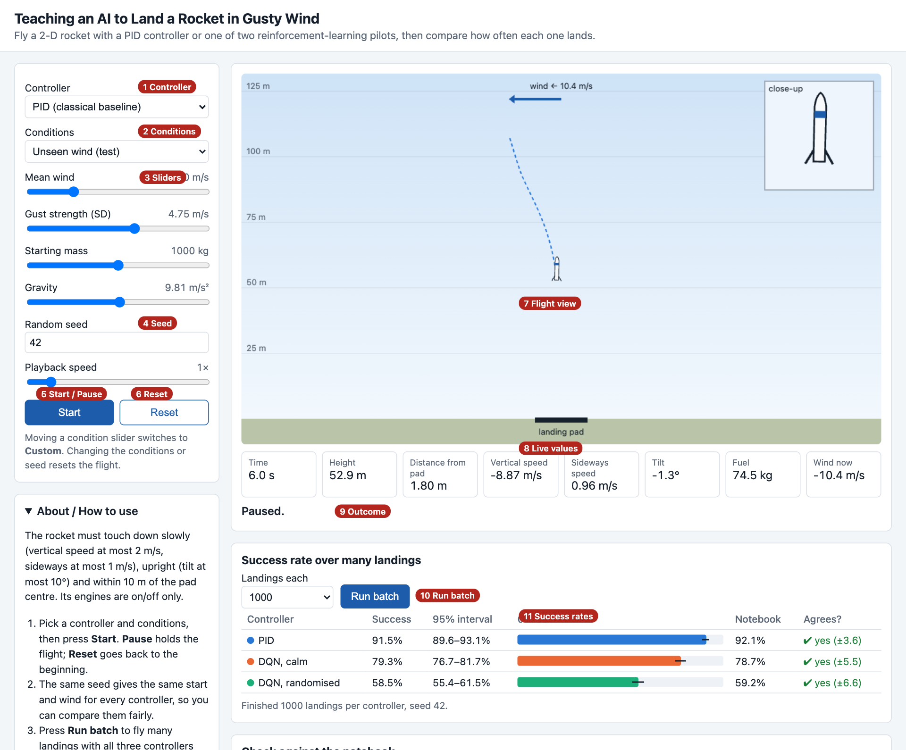

# User guide: Teaching an AI to Land a Rocket in Gusty Wind (web demo)

**Open the demo:** [https://nipunmeegoda.github.io/rl-rocket-simulator/](https://nipunmeegoda.github.io/rl-rocket-simulator/). It runs entirely in your browser (current Chrome, Edge or Firefox). Nothing is installed or uploaded. You can also download the repository and double-click `docs/index.html`.

## Controls

| Control | What it does | Range | Default |
|---|---|---|---|
| Controller | Which pilot flies the rocket: PID, DQN trained in calm air, or DQN trained with domain randomisation | — | [TODO] |
| Mean wind speed | Average horizontal wind (m/s); positive blows to the right | [TODO] | [TODO] |
| Gust strength | How strongly the wind fluctuates around its mean (m/s) | [TODO] | [TODO] |
| Initial mass / fuel | Starting mass of the rocket (kg), including fuel | [TODO] | [TODO] |
| Random seed | Fixes the random wind and start position so a run can be repeated exactly | integer ≥ 1 | 42 |
| Start / Pause | Runs or pauses the simulation | — | — |
| Reset | Clears the run and applies the current settings | — | — |

## Reading the outputs

- **Rocket view:** the rocket, its engine flames and the landing pad, with an arrow showing the current wind. The trail shows the path flown.
- **Touchdown state:** vertical speed, horizontal speed, tilt angle and distance from the pad at contact, compared with the landing limits.
- **Outcome:** *Landed* if every touchdown value is within the limits, otherwise *Crashed* (or *Out of fuel* / *Out of bounds*).
- **Batch success rate:** over N repeated episodes, the fraction that landed, with a 95% confidence interval. The interval narrows roughly as $1/\sqrt{N}$.

## Try this

1. [TODO: e.g. "Choose the PID controller, set the mean wind to 0 and press Start. The rocket should land in about N s."]
2. [TODO: e.g. "Raise the gust strength to X m/s and run a batch of 200 episodes with each controller. Compare the success rates and their confidence intervals."]

## Check against the notebook

With the default settings, the demo should give **[TODO: value ± tolerance]**, matching the notebook result in section [TODO: N].

## Limitations

- The demo runs the same physics as the notebook, but in JavaScript, so tiny floating-point differences can change individual episodes; batch success rates agree within the stated tolerance.
- The DQN policies are the networks trained in the notebook, exported to the page; they are not retrained in the browser.
- [TODO: parameter ranges where results are not reliable, e.g. wind far outside the training range.]
